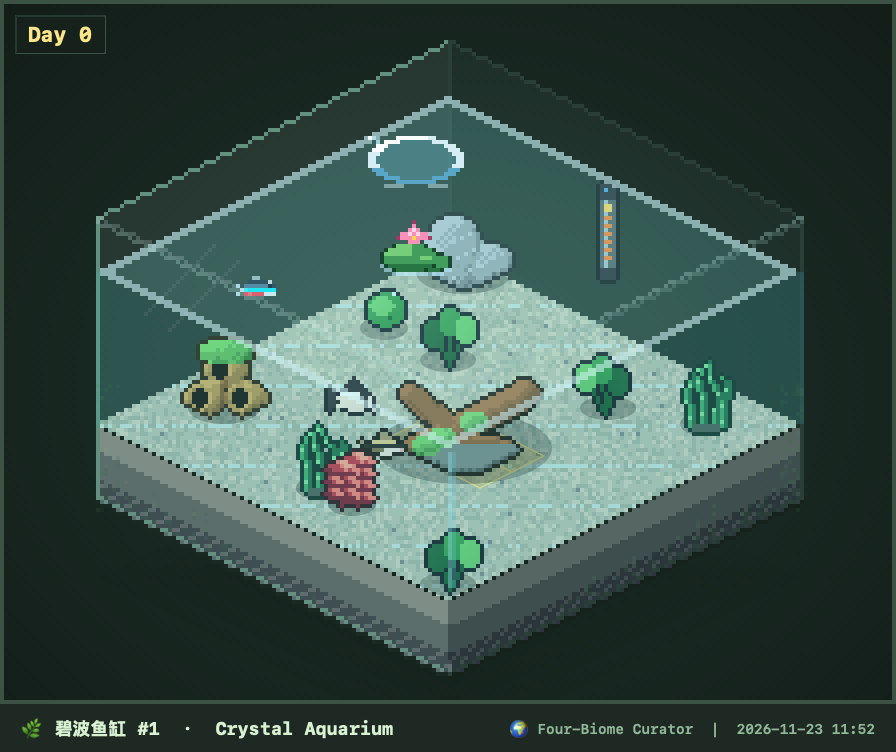

# 🌿 Pixel Terrarium

> Ein gemütliches Pixel-Art-Terrarium, das still in deiner macOS-Menüleiste lebt.

[English](../../README.md#english) | [简体中文](../../README.md#简体中文) | [繁體中文](README.zh-Hant.md) | [日本語](README.ja.md) | [한국어](README.ko.md) | [Español](README.es.md) | **Deutsch** | [Français](README.fr.md)

<p align="center">
  
</p>

### 📸 Screenshots

| 🌿 Feuchtwiese (Lush Meadow) | 🏜️ Sonnige Wüste (Sunlit Desert) |
| :---: | :---: |
|  |  |
| **🌴 Tropischer Regenwald (Tropical Rainforest)** | **🐟 Kristall-Aquarium (Crystal Aquatic)** |
|  |  |

---

### ✨ Hauptmerkmale

- **4 Biome (bis zu 9 Terrarien gleichzeitig)**: Starte mit einem kostenlosen **Wiesen-Terrarium** und schalte **Wüste**, **Regenwald** und **Aquarium** frei – inklusive **Öko-Resonanz** zwischen den Becken.
- **52 sammelbare Arten**:
  - **21 Pflanzen**: Moos, Farne, Leuchtpilze, Sukkulenten, Orchideen, Marimo-Mooskugeln, Seerosen u. v. m.
  - **25 Tiere**: Laubfrösche, Schnecken, Marienkäfer, Leopardgeckos, Chamäleons, Neonsalmler, Kristallgarnelen u. v. m. (mit sicherer Aufbewahrung & Spitznamen).
  - **6 Luft-Besucher**: Glühwürmchen, Mondspinner, Libellen und weitere seltene Gäste bei passenden Bedingungen.
- **Pflege & Verbundenheit**: Besprühen/Belüften, Füttern, Klimageräte (Wärmelampe, Lüfter, Heizstab), 20 frei platzierbare Deko-Objekte, 5 Rahmen-Skins und Streicheln bis **Freundschafts-Stufe Lv.5**.
- **Menüleisten-Erlebnis**: Dynamisches 6-Zustands-Icon, Sonnenauf-/-untergangslicht, bis zu 8 Stunden Offline-Simulation, Schlafmodus (Glasdeckel) und **verlustfreier 4x-PNG-Snapshot-Export**.
- **8 Sprachen integriert**: Deutsch, English, 简体中文, 繁體中文, 日本語, 한국어, Español und Français.

### 💻 Installation (macOS 13.0+)

1. Lade die neueste `.dmg`-Datei von [GitHub Releases](https://github.com/jampsn/TerrariumMenuBar/releases) oder [itch.io](https://jamplus.itch.io/pixel-terrarium) herunter.
2. Ziehe `TerrariumMenuBar.app` in den Ordner `Programme` (`/Applications`).
3. **Hinweis zum ersten Start (nicht signierte App)**: Da dies ein kostenloses Indie-Open-Source-Projekt ohne kostenpflichtiges Apple-Developer-Zertifikat ist, kann macOS Gatekeeper eine Warnung anzeigen.
   - **Option A**: Rechtsklick auf `TerrariumMenuBar.app` → **Öffnen** → im Dialog erneut **Öffnen** bestätigen.
   - **Option B**: Im Terminal ausführen:
     ```bash
     xattr -cr /Applications/TerrariumMenuBar.app
     ```

### 🛠️ Aus dem Quellcode bauen

Erfordert **macOS 13.0+** und **Swift 5.9+**:

```bash
./build_app.sh
```

### 🛠️ Entwicklung & KI-Hinweis

Unabhängig entworfen, entwickelt und ausbalanciert von **jam**. Während der Entwicklung wurden KI-Tools unterstützend für Code-Gerüste sowie Cover-/Konzeptgrafiken eingesetzt; alle Spielmechaniken, Animationen und Interaktionen wurden manuell kuratiert und getestet.

### ❤️ Projekt unterstützen

Pixel Terrarium ist **100 % kostenlos und Open Source**. Wenn dir diese kleine Welt Ruhe auf dem Schreibtisch schenkt, freuen wir uns über eine kleine Unterstützung (vorrangig für das Apple-Developer-Zertifikat zur Entfernung der Sicherheitswarnung):

- 🎮 **itch.io (Pay What You Want)**: [https://jamplus.itch.io/pixel-terrarium](https://jamplus.itch.io/pixel-terrarium)

### 📄 Lizenz

- **Quellcode (`Sources/**/*.swift`, Skripte)**: [MIT License](../../LICENSE)
- **Grafiken & Assets (`Sources/TerrariumMenuBar/Resources/Pixel/`, `AppIcon.icns`, Cover)**: **CC BY-NC-SA 4.0** (Nicht-kommerziell). Details siehe [LICENSE](../../LICENSE).
