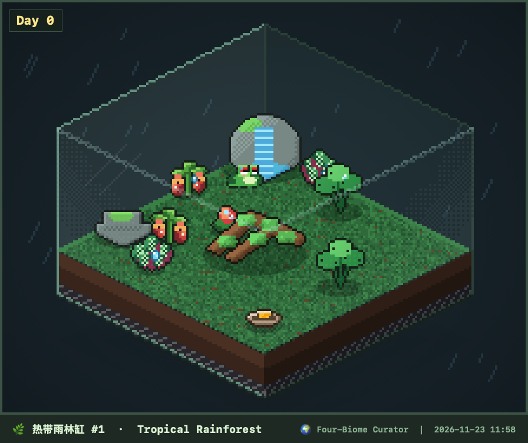

# 🌿 Pixel Terrarium

> Un acogedor terrario en pixel art que vive silenciosamente en la barra de menús de tu Mac.

[English](../../README.md#english) | [简体中文](../../README.md#简体中文) | [繁體中文](README.zh-Hant.md) | [日本語](README.ja.md) | [한국어](README.ko.md) | **Español** | [Deutsch](README.de.md) | [Français](README.fr.md)

<p align="center">
  
</p>

### 📸 Capturas de pantalla

| 🌿 Pradera Húmeda (Lush Meadow) | 🏜️ Desierto Soleado (Sunlit Desert) |
| :---: | :---: |
|  |  |
| **🌴 Selva Tropical (Tropical Rainforest)** | **🐟 Acuario Cristalino (Crystal Aquatic)** |
|  |  |

---

### ✨ Características principales

- **4 Biomas distintos (hasta 9 terrarios)**: Comienza con un terrario gratuito de **Pradera** y desbloquea **Desierto Soleado**, **Selva Tropical** y **Acuario Cristalino**, con **Eco-Resonancia** entre terrarios.
- **52 Especies coleccionables**:
  - **21 Plantas**: Musgo, helechos, setas luminosas, suculentas, orquídeas, bolas de musgo marimo, lotos y más.
  - **25 Criaturas adoptables**: Ranas arborícolas, caracoles, mariquitas, geckos leopardo, camaleones, neones, gambas cristal y más (con almacenamiento seguro según cadena alimenticia y apodos personalizados).
  - **6 Visitantes aéreos**: Luciérnagas, polillas lunares, libélulas y otros visitantes raros que aparecen cuando el hábitat es propicio.
- **Cuidado diario y vínculo**: Pulveriza agua u oxigena, alimenta, usa equipo térmico (lámpara de calor, ventilador, calentador de acuario), decora con 20 objetos movibles y 5 marcos, y acaricia a tus criaturas hasta alcanzar **Afinidad Nv.5**.
- **Nativo en la barra de menús**: Icono dinámico de 6 estados, iluminación de amanecer/atardecer, hasta 8 horas de simulación offline, Modo Sueño y exportación de **capturas pixel art 4x sin pérdida**.
- **8 idiomas incluidos**: Español, English, 简体中文, 繁體中文, 日本語, 한국어, Deutsch y Français.

### 💻 Instalación (macOS 13.0+)

1. Descarga el archivo `.dmg` más reciente desde [GitHub Releases](https://github.com/jampsn/TerrariumMenuBar/releases) o [itch.io](https://jamplus.itch.io/pixel-terrarium).
2. Arrastra `TerrariumMenuBar.app` a `/Applications`.
3. **Nota de primer inicio (app sin firmar)**: Al ser un proyecto indie gratuito sin certificado de Apple Developer aún, macOS Gatekeeper puede mostrar un aviso.
   - **Opción A**: Clic derecho en `TerrariumMenuBar.app` → **Abrir** → confirmar **Abrir**.
   - **Opción B**: Ejecuta en Terminal:
     ```bash
     xattr -cr /Applications/TerrariumMenuBar.app
     ```

### 🛠️ Compilar desde el código fuente

Requiere **macOS 13.0+** y **Swift 5.9+**:

```bash
./build_app.sh
```

### 🛠️ Desarrollo y divulgación de IA

Diseñado, programado y equilibrado de forma independiente por **jam**. Durante el desarrollo se utilizaron herramientas de IA como asistencia para el código y exploración visual/portada; toda la jugabilidad, animaciones e interacciones han sido revisadas y probadas manualmente.

### ❤️ Apoya el proyecto

Pixel Terrarium es **100% gratuito y de código abierto**. Si este pequeño mundo aporta calma a tu escritorio, puedes apoyar futuras actualizaciones (y ayudar a cubrir el certificado de Apple Developer):

- 🎮 **itch.io (Pay What You Want)**: [https://jamplus.itch.io/pixel-terrarium](https://jamplus.itch.io/pixel-terrarium)

### 📄 Licencia

- **Código fuente (`Sources/**/*.swift`, scripts)**: [Licencia MIT](../../LICENSE)
- **Recursos visuales (`Sources/TerrariumMenuBar/Resources/Pixel/`, `AppIcon.icns`, portadas)**: **CC BY-NC-SA 4.0** (No Comercial). Consulta [LICENSE](../../LICENSE).
