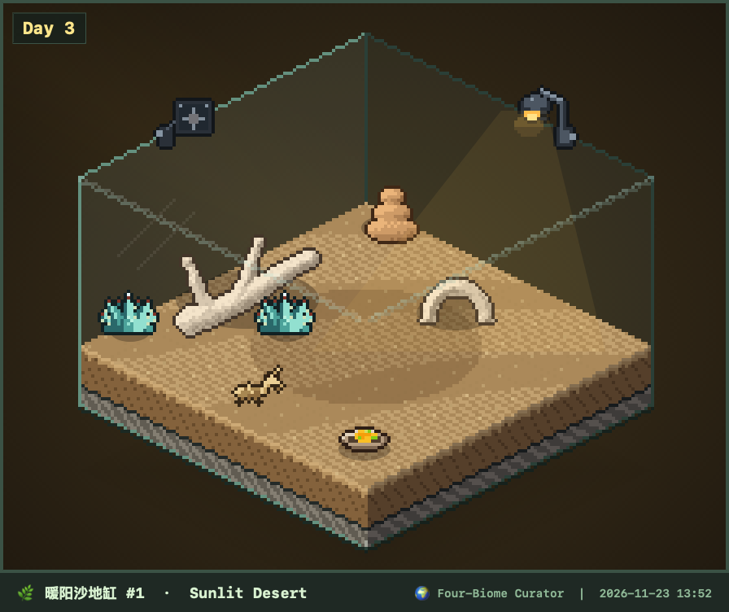

# 🌿 Pixel Terrarium

> macOS のメニューバーにそっと棲む、癒やし系ピクセル・テラリウムデスクトップパートナー。

[English](../../README.md#english) | [简体中文](../../README.md#简体中文) | [繁體中文](README.zh-Hant.md) | **日本語** | [한국어](README.ko.md) | [Español](README.es.md) | [Deutsch](README.de.md) | [Français](README.fr.md)

<p align="center">
  
</p>

### 📸 スクリーンショット

| 🌿 潤いの草原 (Lush Meadow) | 🏜️ 陽だまりの砂地 (Sunlit Desert) |
| :---: | :---: |
|  |  |
| **🌴 熱帯雨林 (Tropical Rainforest)** | **🐟 澄んだ水槽 (Crystal Aquatic)** |
|  |  |

---

### ✨ 主な特徴

- **4 種類のバイオーム（最大 9 個のタンクを同時育成）**：無料の **草原タンク** から始め、**砂漠**・**熱帯雨林**・**アクアリウム** を解放。複数タンクの運用で「生態共鳴」が発動します。
- **52 種の図鑑コレクション**：
  - **植物 21 種**：コケ、シダ、光るキノコ、多肉植物、ラン、マリモ、スイレンなど。
  - **生き物 25 種**：アマガエル、カタツムリ、テントウムシ、ヒョウモントカゲモドキ、カメレオン、ネオンテトラ、レッドビーシュリンプなど（食物連鎖に配慮した安全保管・ニックネーム機能付き）。
  - **空の来訪者 6 種**：ホタル、ミズアオ・ガ、トンボなど、環境条件が揃うと自然に飛来するレア種。
- **お手入れと絆システム**：霧吹き・エアレーション、餌やり、温度管理機器（ヒートランプ、冷却ファン、水中ヒーター）、20 種のレイアウト小物、5 種のフレームスキン、なでなでによる好感度（Lv.5 親友）育成に対応。
- **メニューバー特化設計**：状態に応じた 6 パターンの動的アイコン、朝夕のライティング変化、最大 8 時間のオフライン進行、スリープモード（ガラス蓋）、**4x ロスレス PNG スナップショット**書き出し。
- **8 言語ネイティブ対応**：日本語、English、简体中文、繁體中文、한국어、Español、Deutsch、Français。

### 💻 インストール方法（macOS 13.0+）

1. [GitHub Releases](https://github.com/jampsn/TerrariumMenuBar/releases) または [itch.io](https://jamplus.itch.io/pixel-terrarium) から最新の `.dmg` をダウンロードします。
2. `TerrariumMenuBar.app` を「アプリケーション」フォルダへドラッグします。
3. **初回起動時の注意（未署名アプリ）**：現在 Apple Developer ID による公証前のため、macOS Gatekeeper の警告が表示される場合があります。
   - **方法 A**：`TerrariumMenuBar.app` を右クリック →「開く」→ 確認ダイアログで再度「開く」。
   - **方法 B**：ターミナルで以下を実行：
     ```bash
     xattr -cr /Applications/TerrariumMenuBar.app
     ```

### 🛠️ ソースからビルド

**macOS 13.0+** および **Swift 5.9+** が必要です：

```bash
./build_app.sh
```

### 🛠️ 開発・AI 利用に関する透明性（Disclosure）

本プロジェクトは **jam** が設計・アーキテクチャ・ゲームバランス調整を主導して開発しました。開発過程ではコード作成や一部ビジュアル・カバー画像の探索に AI ツールを補助として活用し、すべてのゲームシステムとアニメーションは手作業で精査・調整・テストを行っています。

### ❤️ プロジェクトを支援する

Pixel Terrarium は **完全無料・オープンソース** です。もしこの小さな世界が日々の癒やしになりましたら、ご支援いただけますと幸いです（ご支援は Apple Developer 登録費用の確保に優先充当されます）：

- 🎮 **itch.io（Pay What You Want）**：[https://jamplus.itch.io/pixel-terrarium](https://jamplus.itch.io/pixel-terrarium)

### 📄 ライセンス

- **ソースコード (`Sources/**/*.swift`, scripts)**：[MIT License](../../LICENSE)
- **アート・画像アセット (`Sources/TerrariumMenuBar/Resources/Pixel/`, `AppIcon.icns`, カバー画像)**：**CC BY-NC-SA 4.0**（非商用）。詳細は [LICENSE](../../LICENSE) をご確認ください。
