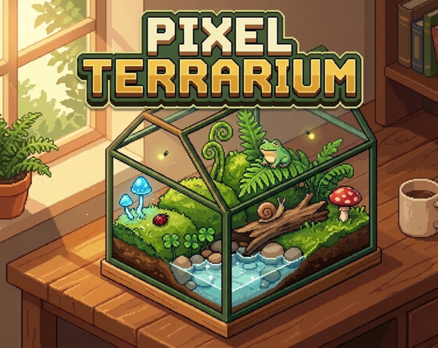
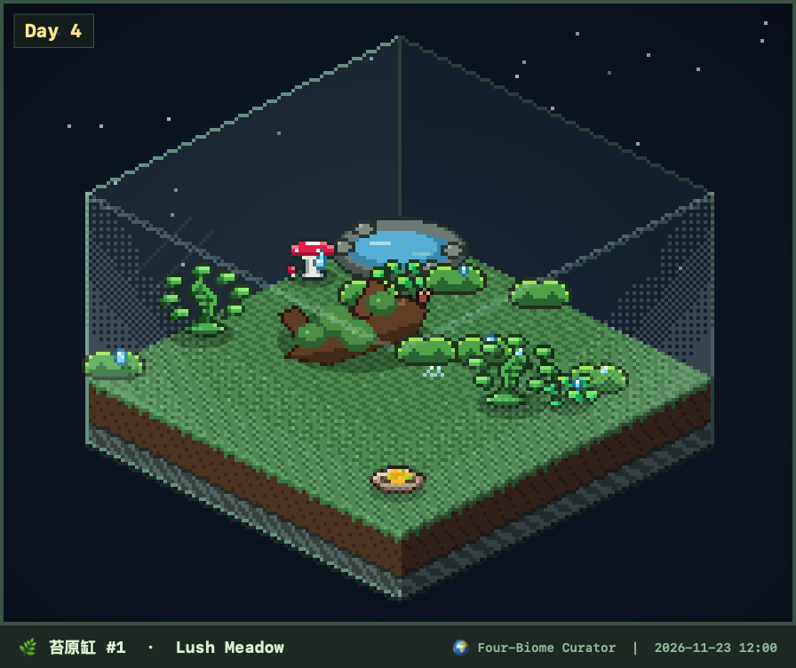

# 🌿 Pixel Terrarium（像素生態箱）

> 一款安靜棲息在 macOS 選單列裡的療癒系像素生態缸桌面夥伴。

[English](../../README.md#english) | [简体中文](../../README.md#简体中文) | **繁體中文** | [日本語](README.ja.md) | [한국어](README.ko.md) | [Español](README.es.md) | [Deutsch](README.de.md) | [Français](README.fr.md)

<p align="center">
  
</p>

### 📸 遊戲截圖

| 🌿 溫潤苔原缸 | 🏜️ 暖陽沙地缸 |
| :---: | :---: |
|  |  |
| **🌴 熱帶雨林缸** | **🐟 碧波魚缸** |
|  |  |

---

### ✨ 核心特色

- **四大生態缸體（最多同時養護 9 口缸）**：從免費初始的 **溫潤苔原缸** 起步，逐步解鎖 **暖陽沙地缸**、**熱帶雨林缸** 與 **碧波魚缸**，多缸並存時可觸發「跨缸生態共鳴」。
- **52 種像素物種圖鑑**：
  - **21 種植物**：絨球苔蘚、微光菇、仙人球、龜背竹、莫斯藻球、迷你睡蓮等，滿足條件即觸發首株必出萌發。
  - **25 種可領養動物**：綠豆樹蛙、露珠蝸牛、七星瓢蟲、豹紋守宮、七彩變色龍、紅綠燈魚、水晶紅蝦等，支援食物鏈安全存倉與自訂暱稱。
  - **6 種空中奇遇訪客**：微光螢火蟲、月光小飛蛾、碧藍蜻蜓等稀有訪客，在溫濕度與造景契合時自然現身。
- **細膩照料與羈絆互動**：支援噴水/打氧、投餵、夾缸溫控設備（加熱燈/降溫扇/水底加熱棒）、20 件自由擺件與 5 款缸框皮膚；輕撫動物提升好感度至 Lv.5 摯友，解鎖專屬暖心微敘事。
- **選單列專屬體驗**：6 態動態選單列圖示、晨昏光影漸層、最高 8 小時離線模擬結算、一鍵蓋上玻璃蓋進入休眠，以及 **4x 無損像素快照** 匯出。
- **原生 8 語種支援**：繁體中文、簡體中文、English、日本語、한국어、Español、Deutsch、Français。

### 💻 安裝與首次打開說明（macOS 13.0+）

1. 前往 [GitHub Releases](https://github.com/jampsn/TerrariumMenuBar/releases) 或 [itch.io](https://jamplus.itch.io/pixel-terrarium) 下載最新 `.dmg` 安裝檔。
2. 將 `TerrariumMenuBar.app` 拖入「應用程式」資料夾。
3. **首次打開提示「無法驗證開發者」**：目前為個人獨立免費開源分發，尚未購買 Apple 開發者公證憑證：
   - **方法一**：右鍵點擊 `TerrariumMenuBar.app` → 選擇「打開」→ 彈窗中再次點擊「打開」。
   - **方法二**：在終端機執行：
     ```bash
     xattr -cr /Applications/TerrariumMenuBar.app
     ```

### 🛠️ 原始碼建置

需要 **macOS 13.0+** 及 **Swift 5.9+**：

```bash
./build_app.sh
```

### 🛠️ 開發說明（Transparency）

本專案由 **jam** 主導設計、架構與測試調校；開發過程中藉助 AI 工具輔助進行了程式碼編寫與部分視覺/封面素材探索，並經人工逐項修整與驗證。

### ❤️ 支持作者

如果這方小小的像素玻璃缸陪伴了你的工作與休憩時光，歡迎支持本專案（贊助目標將優先用於申請 Apple 開發者憑證以消除系統彈窗）：

- 🎮 **itch.io**：[https://jamplus.itch.io/pixel-terrarium](https://jamplus.itch.io/pixel-terrarium)

### 📄 License

- **Source Code (`Sources/**/*.swift`, scripts)**: [MIT License](../../LICENSE)
- **Art Assets (`Sources/TerrariumMenuBar/Resources/Pixel/`, `AppIcon.icns`, cover images)**: **CC BY-NC-SA 4.0** (Non-Commercial). See [LICENSE](../../LICENSE).
